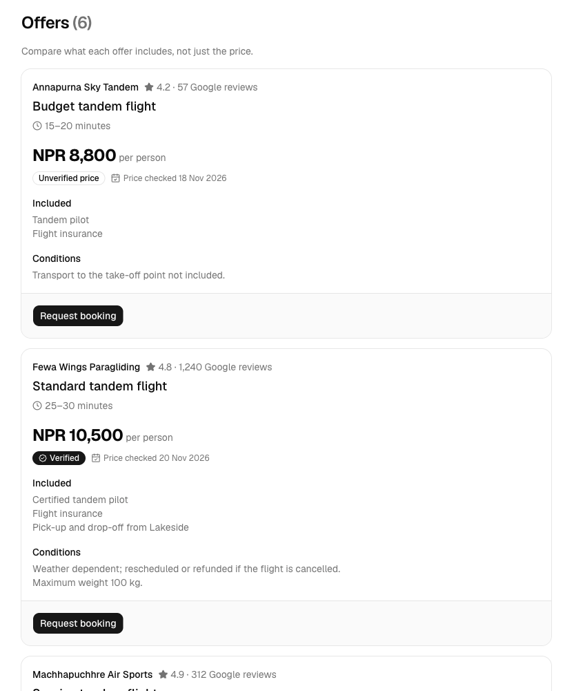
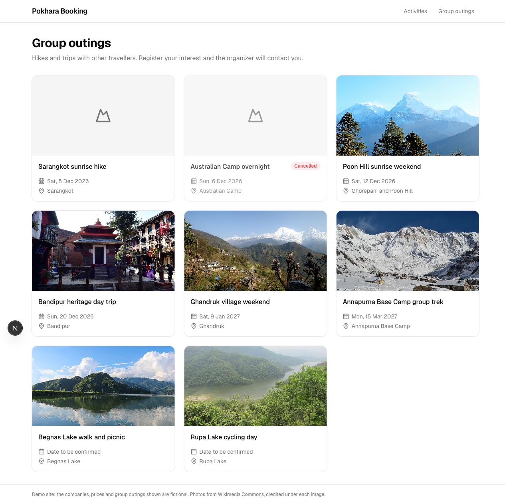

# Pokhara Booking

Compare and request adventure activities in Pokhara, Nepal, from several local companies in one place, and join hiking and travel group outings.

Visitors browse activities (paragliding, boating, ziplining…), compare offers from different providers side by side, and send a **booking request**. Staff check availability with the provider, contact the customer, and record the outcome in a small password-protected admin. Visitors can also register interest in **group outings** that an organizer follows up on.

> **Status:** MVP / single-user demo. It ships with realistic **fictional** demo data: 10 companies, 25 offers and 10 group outings (see [Demo data](#demo-data)). The site footer says so.


---

## Contents

- [Features](#features)
- [Tech stack](#tech-stack)
- [Getting started](#getting-started)
- [Environment variables](#environment-variables)
- [Database](#database)
- [Demo data](#demo-data)
- [Scripts](#scripts)
- [Project structure](#project-structure)
- [Security model](#security-model)
- [Documentation](#documentation)
- [Deploying](#deploying)
- [Not in this MVP](#not-in-this-mvp)

---

## Features

### For visitors

| Page | What it does |
|---|---|
| `/` | Catalogue of published activities with photos, category and location. |
| `/activities/[slug]` | Activity details and **offers to compare**: provider, Google rating, package, duration, price (`NPR 8,500 per person`), Verified / Unverified badge, price-checked date, what's included and conditions. Outdated or unpriced offers are hidden. |
| Request booking (dialog) | Name, phone or email, date and number of people, with a live estimated total. The server re-checks the offer: if it was withdrawn or its price changed, nothing is saved and the visitor reviews the new terms. On success the visitor gets a reference like `PKR-7EV5GB` and is told the request is **pending, not a confirmed booking**. |
| `/outings`, `/outings/[slug]` | Hiking and travel group outings. Visitors register interest (name, contact, number of people). Cancelled and past outings stop taking interest. |

### For staff (`/admin`, password-protected)

| Section | What it does |
|---|---|
| **Overview** | Counts of live activities, offers by status, providers and pending booking requests. |
| **Activities** | Add and edit activities, a one-click **Live / Hidden** switch, photo with credit. |
| **Offers** | Add and edit prices; filter by activity and status; **Verify** / **Outdated** in one click; each row says whether visitors can see it, and why not. |
| **Providers** | Public name and Google rating; phone, address and notes stay staff-only. |
| **Outings** | Plan outings (draft / published / cancelled), see who's interested, copy all contacts, ready-made messages. |
| **Requests** | Pending requests oldest first (overdue after 2 days), search by reference, name, phone or email; Call / WhatsApp / Email buttons; the offer exactly as the customer saw it, with a notice when the live offer has since changed; copyable customer messages; record **Confirmed / Rejected / Cancelled** with a reason and staff name. |

Nothing in the admin is ever deleted: activities are hidden, offers marked outdated, outings cancelled. Booking requests keep a frozen copy of the offer, so editing an offer never changes requests already sent.

Admin screenshots and step-by-step instructions are in the **[Admin guide](docs/admin-guide.md)**.

---

## Tech stack

- **[Next.js 16](https://nextjs.org)** (App Router, Server Components, Server Actions, Cache Components, Turbopack)
- **React 19**, **TypeScript**
- **[Tailwind CSS 4](https://tailwindcss.com)** and **[shadcn/ui](https://ui.shadcn.com)** (Base UI), **lucide-react** icons, **sonner** toasts
- **[Supabase](https://supabase.com)** (Postgres + Row Level Security) via `@supabase/supabase-js` and `@supabase/ssr`
- **[Vitest](https://vitest.dev)** for unit tests

> This Next.js version has breaking changes compared to older releases. Its docs ship in `node_modules/next/dist/docs/`; check them before changing framework code (see `AGENTS.md`).

---

## Getting started

### Prerequisites

- **Node.js 22** or newer and npm
- A **Supabase** project (the free tier is fine)

### 1. Install

```bash
git clone https://github.com/Krishesh/pokhara-booking.git
cd pokhara-booking
npm install
```

### 2. Configure environment variables

```bash
cp .env.example .env.local
```

Fill in `.env.local` as described in [Environment variables](#environment-variables).

### 3. Set up the database

In the Supabase dashboard, open **SQL Editor** and run these files **in this order** (paste the whole file, then **Run**):

1. [`supabase/schema.sql`](supabase/schema.sql): tables, checks, Row Level Security and grants
2. [`supabase/seed.sql`](supabase/seed.sql): 6 demo activities (5 with photos)
3. [`supabase/seed-offers.sql`](supabase/seed-offers.sql): demo providers and offers
4. [`supabase/seed-outings.sql`](supabase/seed-outings.sql): demo group outings
5. [`supabase/seed-demo-more.sql`](supabase/seed-demo-more.sql): gives the demo providers realistic names and adds the rest of the [demo data](#demo-data)

All five are safe to run more than once. Skip the seed files for an empty site. Make sure the dashboard is on the same project as `NEXT_PUBLIC_SUPABASE_URL`.

### 4. Run

```bash
npm run dev
```

- Website: <http://localhost:3000>
- Admin: <http://localhost:3000/admin>. Your browser asks for a password: use `ADMIN_PASSWORD` from `.env.local`, with any username.

---

## Environment variables

See [`.env.example`](.env.example).

| Variable | Where to find it | Notes |
|---|---|---|
| `NEXT_PUBLIC_SUPABASE_URL` | Supabase → Project Settings → API | The project URL, e.g. `https://abcd.supabase.co`. **No** `/rest/v1` at the end. |
| `NEXT_PUBLIC_SUPABASE_PUBLISHABLE_KEY` | Supabase → Settings → API Keys → **Publishable key** (`sb_publishable_…`) | Public and read-only by design. |
| `SUPABASE_SERVICE_ROLE_KEY` | Supabase → Settings → API Keys → **Secret key** (`sb_secret_…`) | **Server-only.** Bypasses Row Level Security. Never prefix with `NEXT_PUBLIC_` and never import it in client code. Used for booking requests, outing interest and the admin. |
| `ADMIN_PASSWORD` | You choose it | At least 8 characters. If empty or shorter, `/admin` stays locked. |

Restart `npm run dev` after changing `.env.local`.

---

## Database

`supabase/schema.sql` is the source of truth for tables and columns. Read it before writing queries, and update it first when a feature needs a schema change (see `AGENTS.md`).

| Table | Purpose |
|---|---|
| `activities` | Things to do. `is_published` controls visibility; `image_url` + `image_credit` for photos. |
| `providers` | Companies running activities. Contact details are staff-only. |
| `price_listings` | Offers: a provider's price for an activity (price, currency, unit, inclusions, verification status, source). |
| `booking_requests` | Visitor requests with a reference, contact, date, people, a frozen `offer_snapshot`, the total, and status (`pending` → `confirmed` / `rejected` / `cancelled`). |
| `group_outings` | Hikes and trips: date (or to be confirmed), meeting point, cost text, organizer, status (`draft` / `published` / `cancelled`). |
| `group_interests` | Interest in an outing; one per contact per outing. |

**Who can see what** (enforced in the database, not just in the app):

| Table | Public (publishable key) | Server (service-role key) |
|---|---|---|
| `activities` | Read published rows, public columns | Full |
| `price_listings` | Read non-outdated offers on published activities; no source links or notes | Full |
| `providers` | Read name and rating of providers with a visible offer | Full |
| `group_outings` | Read published and cancelled outings; no organizer contact | Full |
| `booking_requests`, `group_interests` | **No access** | Full |

The public key can't insert, update or delete anything.

---

## Demo data

The seed files fill the site with **realistic but fictional** data, so every feature can be tried straight away.

> **Nothing in the demo data is real.** Company, club and people names were invented and checked against web search to avoid real Pokhara businesses (real operators such as ZipFlyer or Paddle Nepal are deliberately not used). Websites use the reserved `example.com` domain, staff-only phone numbers are marked "(demo)", and outing sign-ups use `example.com` email addresses only. Prices are in line with typical published Pokhara prices for 2026, but they are not quotes from any operator. Every page shows a footer saying the data is fictional.

### Activities and offers



| Activity | Offers shown | Providers | Price range |
|---|---|---|---|
| Paragliding at Sarangkot | 6 (+1 outdated, hidden) | Fewa Wings Paragliding, Machhapuchhre Air Sports, Sarangkot Skyline Adventures, Annapurna Sky Tandem | NPR 8,800 – 16,000 per person, cross-country USD 150 |
| Boating on Phewa Lake | 5 | Phewa Rowing Cooperative, Lakeside Kayak & SUP | NPR 900 kayak hire – NPR 3,500 SUP lesson; boats NPR 1,000 – 1,500 per group |
| Ultralight Flight | 4 (+1 without a price, hidden) | Kaski Ultralight Flights, Machhapuchhre Air Sports, Sarangkot Skyline Adventures | NPR 16,500 – 46,000 per flight, 15-minute flight USD 125 |
| Zipline at Sarangkot | 3 | Seti River Zipline, one "Listed on" offer with no provider | NPR 6,000 – 8,800 per person |
| Bungee Jump at Hemja | 3 | Hemja Gorge Bungee | NPR 10,500 – 18,000 per person |
| World Peace Pagoda Hike | 2 | Pokhara Valley Guides | NPR 2,500 per person, private sunrise hike NPR 6,000 per group |

The offers cover every case the site handles: verified and unverified prices, NPR and USD, per person, per group, per flight and **per hour** (the guided kayak tour, shown as "Online requests aren't available"), an offer without a provider, an outdated offer and an offer without a price (both hidden). Providers have Google ratings from 4.2 to 4.9.

Five activities have Wikimedia Commons photos. Bungee Jump at Hemja has none (placeholder) and is **hidden** by the seed; switch it to Live in the admin to show it.

### Group outings



| Outing | Date | Organizer | Status |
|---|---|---|---|
| Sarangkot sunrise hike | 5 Dec 2026 | Lakeside Trekking Circle | Published |
| Australian Camp overnight | 6 Dec 2026 | Lakeside Trekking Circle | **Cancelled** (shown with a label, form off) |
| Poon Hill sunrise weekend | 12 Dec 2026 | Lakeside Trekking Circle | Published |
| Bandipur heritage day trip | 20 Dec 2026 | Lakeside Trekking Circle | Published |
| Ghandruk village weekend | 9 Jan 2027 | Pokhara Weekend Walkers | Published |
| Annapurna Base Camp group trek | 15 Mar 2027 | Himalayan Trail Friends | Published |
| Begnas Lake walk and picnic | to be confirmed | Pokhara Weekend Walkers | Published |
| Rupa Lake cycling day | to be confirmed | Pokhara Weekend Walkers | Published |
| Mardi Himal trek, Panchase overnight trek | to be confirmed | | **Draft** (hidden) |

Seven sign-ups are spread over four outings (for example 3 for Annapurna Base Camp, 6 people in total), so the admin's "Interested people" list and templates have data.

The dates are fixed, and outings drop off the public list once their date passes. Edit the dates in the admin (or in `supabase/seed-demo-more.sql`) to keep the demo fresh.

### Booking requests

The seed files don't create booking requests. Send one from any activity page (**Request booking**), then review it under **Admin → Requests**.

### Removing the demo data

Before using the site for real, remove the seed data in the Supabase SQL editor, children first:

```sql
delete from public.group_interests;
delete from public.group_outings;
delete from public.booking_requests;
delete from public.price_listings;
delete from public.providers;
delete from public.activities;
```

**This permanently deletes every row in those tables**, including any real data added since. Then add real activities, providers and offers through the admin, and remove the "fictional" footer from `src/app/layout.tsx`.

---

## Scripts

| Command | What it does |
|---|---|
| `npm run dev` | Start the dev server at <http://localhost:3000> |
| `npm run build` | Production build (also type-checks) |
| `npm start` | Run the production build |
| `npm run lint` | ESLint |
| `npm test` | Vitest unit tests (pricing, validation, references, admin auth, request and outing logic) |

---

## Project structure

```
src/
├── app/
│   ├── page.tsx                      # Activity catalogue (home)
│   ├── activities/[slug]/            # Activity page, offers, booking request action
│   ├── outings/                      # Group outings list and pages, interest action
│   ├── admin/                        # Admin: overview, activities, offers, providers, outings, requests
│   ├── layout.tsx                    # Header, toasts
│   └── error.tsx                     # Error page with retry
├── components/
│   ├── ui/                           # shadcn/ui components
│   ├── admin/                        # Admin forms, tables, status form, message templates
│   ├── booking-dialog.tsx            # Request booking form
│   ├── interest-form.tsx             # Outing interest form
│   └── offer-card.tsx, offer-list.tsx, activity-image.tsx, …
├── lib/
│   ├── booking.ts                    # Totals, validation, references, snapshots (pure, tested)
│   ├── offer-format.ts               # Price, rating and date formatting, sorting (pure, tested)
│   ├── outings.ts                    # Outing state, sorting, interest validation (pure, tested)
│   ├── activities.ts, offers.ts, outings-data.ts   # Public data reads (publishable key)
│   └── admin/                        # Admin auth, validation, data reads (service-role key)
├── utils/supabase/                   # server.ts (publishable key), admin.ts (service role, server-only)
└── proxy.ts                          # /admin password gate
supabase/                             # schema.sql and seed files
docs/                                 # PRD, task specs, admin guide, image credits
```

Business logic lives in small pure modules (`src/lib/**`) with unit tests next to them (`*.test.ts`); pages and Server Actions wire them to Supabase.

---

## Security model

- **No user accounts** (by design for the MVP). `/admin` is protected by one shared password using the browser's built-in sign-in box (HTTP Basic Auth) in `src/proxy.ts`.
- **Server Actions can be called from any URL**, so every admin action and admin data read re-checks the password with `requireAdmin()` (`src/lib/admin/guard.ts`), not just the proxy.
- The **public key is read-only** and limited by Row Level Security and column grants (see [Database](#database)). Writes go through Server Actions that validate input and use the service-role key, which is guarded by `server-only` so it can't end up in browser code.
- Booking totals are always **calculated on the server** from the stored price, and a changed or withdrawn offer is never silently substituted.
- Public forms use a hidden **honeypot** field to drop bot submissions.
- Admin pages are `noindex`, and there's no link to `/admin` on the public site.

---

## Documentation

| Document | For |
|---|---|
| [`docs/admin-guide.md`](docs/admin-guide.md) | **Staff**: how to use the admin, with screenshots |
| [`docs/Pokhara-Booking-PRD-Krishesh.md`](docs/Pokhara-Booking-PRD-Krishesh.md) | Product requirements, scope and open business questions |
| [`docs/tasks/`](docs/tasks/) | Final spec and acceptance criteria for each feature (01 catalogue → 06 group outings) |
| [`docs/image-credits.md`](docs/image-credits.md) | Photo sources and licences |
| [`AGENTS.md`](AGENTS.md) | Rules for contributors and coding agents |

---

## Deploying

The app deploys like any Next.js app (e.g. on [Vercel](https://vercel.com/docs/frameworks/nextjs)). Before going live:

1. Add the four [environment variables](#environment-variables) in the hosting provider's settings.
2. Use a **long, unique `ADMIN_PASSWORD`**, serve the site over **HTTPS only**, and change the password when staff leave.
3. Use a **fresh service-role (secret) key** that has never been in a `NEXT_PUBLIC_` variable or shared anywhere.
4. [Remove the demo data](#removing-the-demo-data), add real, approved activities, providers and offers, remove the "fictional" footer, and resolve the open business questions in the PRD (commission, payments, cancellations and refunds, privacy notice).

---

## Not in this MVP

Deferred on purpose (see the PRD): customer accounts, online payment and commission handling, automatic emails or SMS, live availability and instant confirmation, vendor dashboards, reviews, search and filters on the public site, seat allocation for outings, and data retention rules.

---

## Credits

Activity and outing photos are from [Wikimedia Commons](https://commons.wikimedia.org) under CC BY-SA 4.0; authors are credited under each photo and in [`docs/image-credits.md`](docs/image-credits.md).
