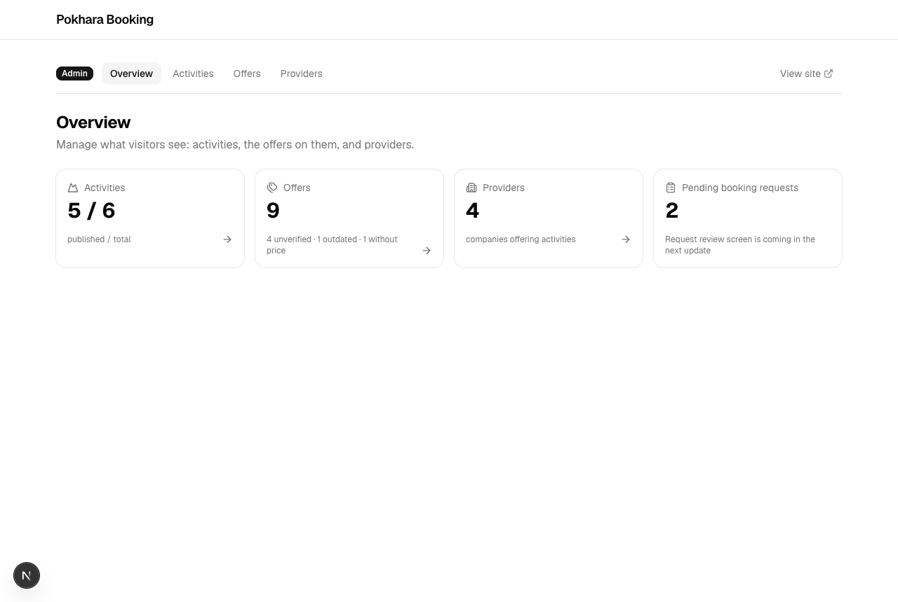
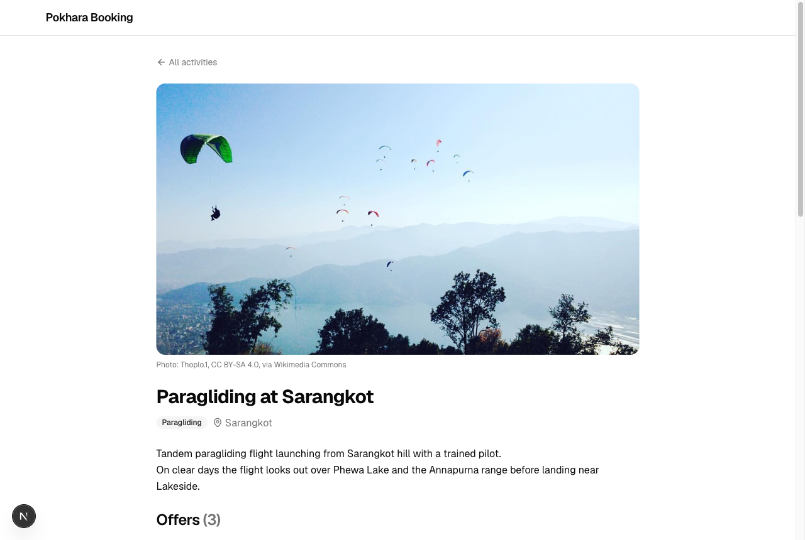
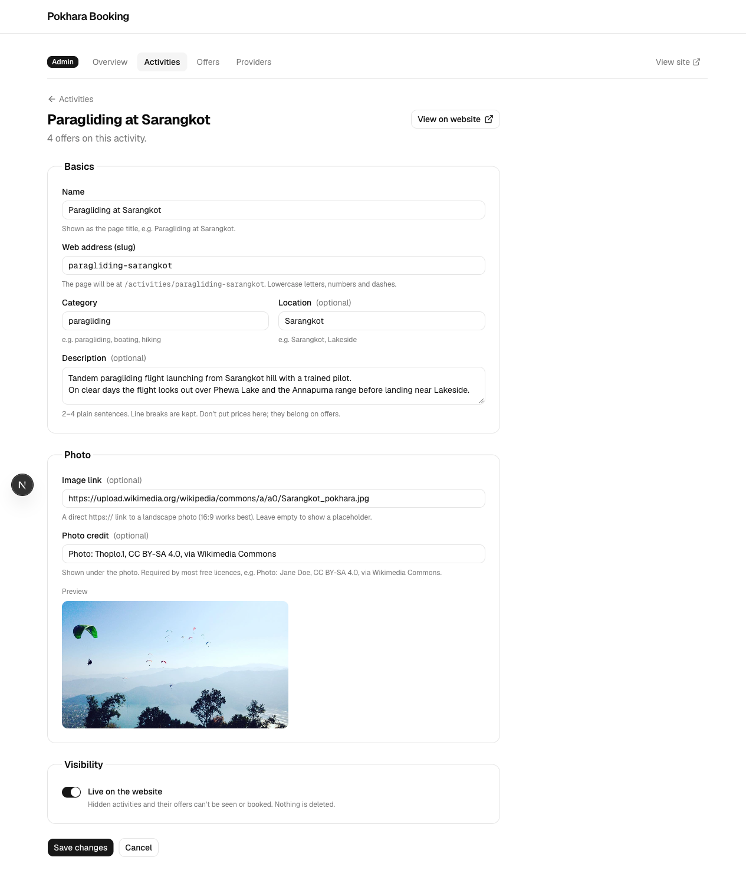
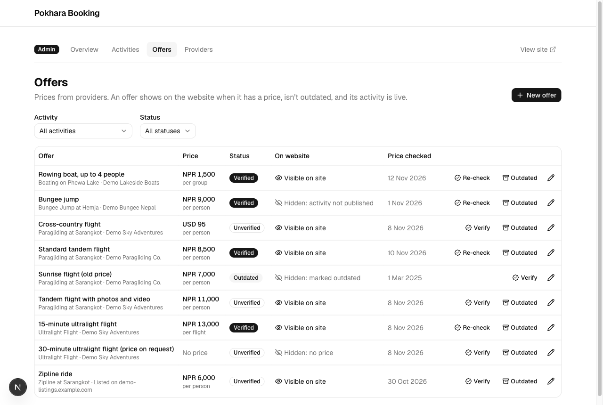
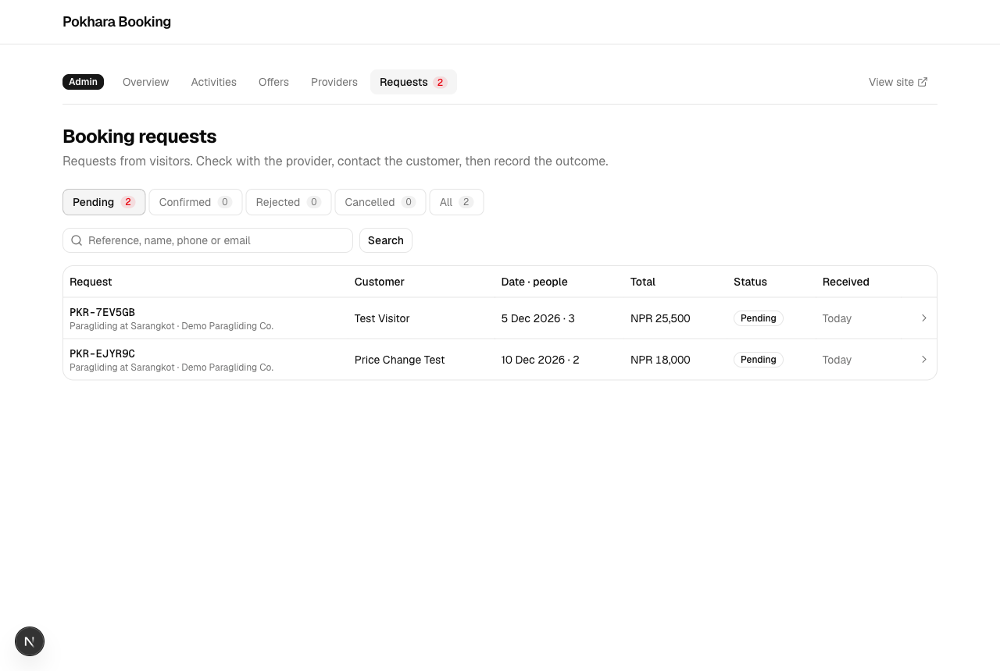
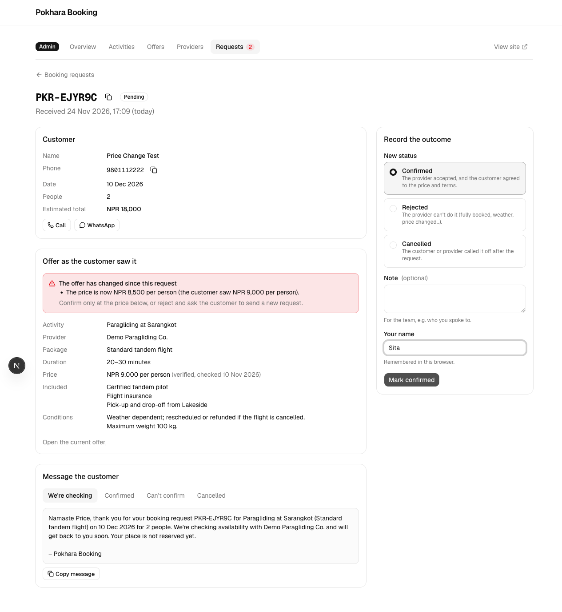
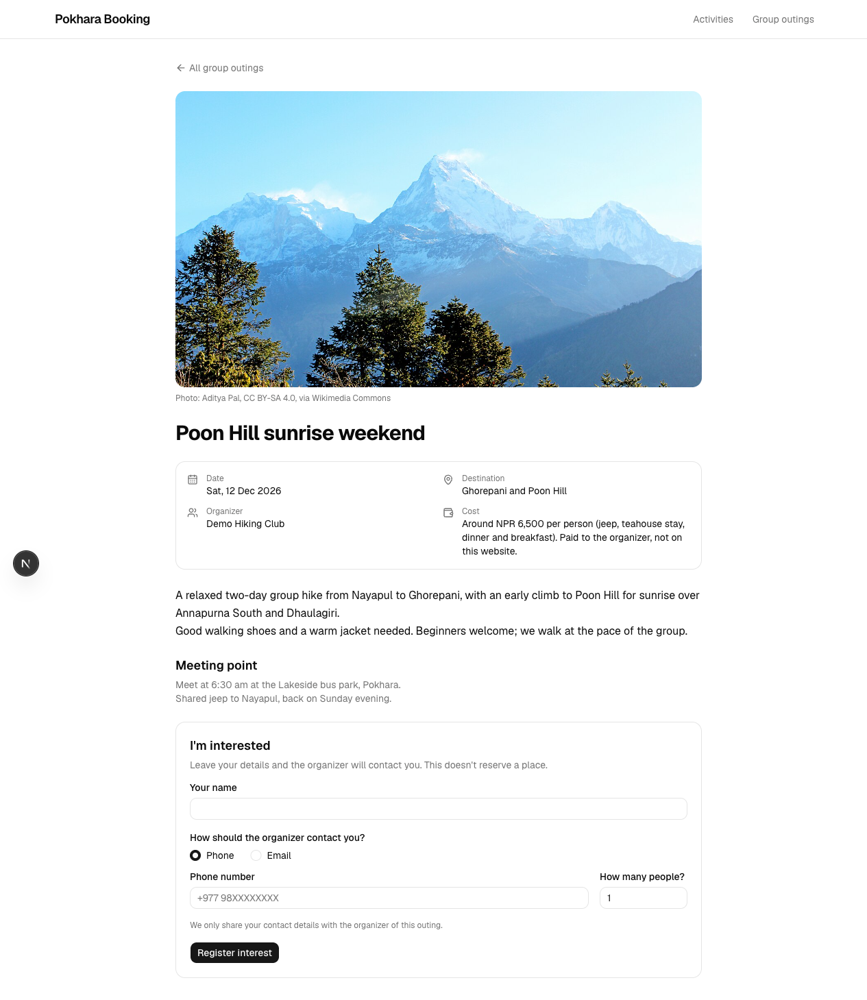
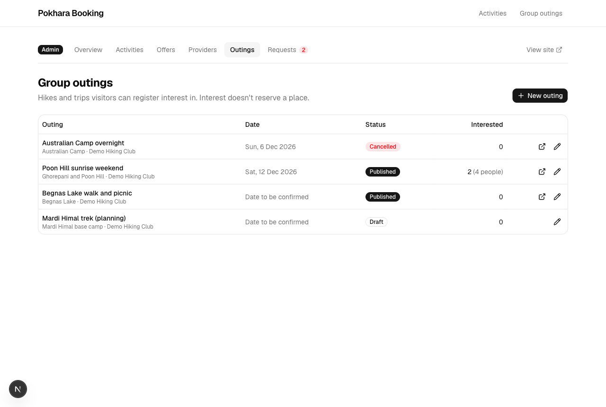
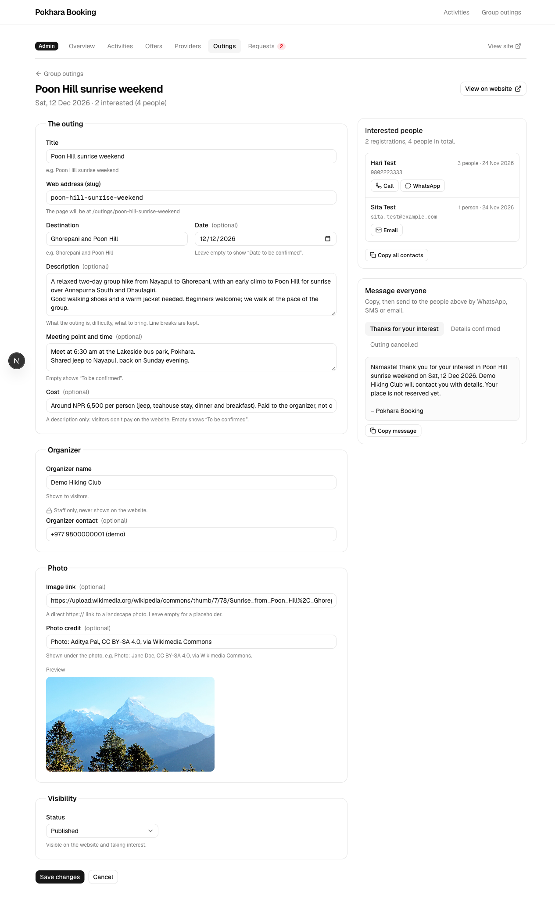

# Pokhara Booking — Admin guide

This guide is for staff who keep the website's activities, prices and companies up to date. No technical knowledge needed.

**In short:** you add **activities** (things to do), **providers** (the companies that run them) and **offers** (a provider's price for an activity). Visitors compare offers and send booking requests. You can also publish **group outings** (hikes and trips) that visitors register interest in. Nothing you do here deletes anything: you hide things instead.

---

## Contents

1. [Getting in](#1-getting-in)
2. [The overview](#2-the-overview)
3. [What visitors can see](#3-what-visitors-can-see)
4. [Activities](#4-activities)
5. [Providers](#5-providers)
6. [Offers and prices](#6-offers-and-prices)
7. [Booking requests](#7-booking-requests)
8. [Group outings](#8-group-outings)
9. [Everyday tasks, step by step](#9-everyday-tasks-step-by-step)
10. [Booking requests and price changes](#10-booking-requests-and-price-changes)
11. [Something went wrong?](#11-something-went-wrong)
12. [Do and don't](#12-do-and-dont)
13. [For developers](#13-for-developers)

---

## 1. Getting in

1. Open **`/admin`** on the website, for example `http://localhost:3000/admin`.
2. Your browser shows a small sign-in box.
   - **Username:** anything (for example `admin`).
   - **Password:** the admin password your developer gave you.
3. Your browser remembers it until you close it.

There is no "Admin" link on the public website on purpose. Bookmark `/admin`.

> If you see **"Admin is disabled"**, the password hasn't been set up on this server yet. Ask your developer (see [For developers](#13-for-developers)).

Every admin page has the same menu at the top: **Overview · Activities · Offers · Providers · Outings · Requests** (with the number of pending requests in red), and **View site** on the right, which opens the public website in a new tab.

---

## 2. The overview

The top row has four cards. Each one links to its section.

| Card | What it tells you |
|---|---|
| **Activities** | How many are live on the website, out of all you've added, and how many are hidden. |
| **Offers** | All prices, with how many are unverified, outdated or missing a price. |
| **Providers** | How many companies you've added, and how many have at least one offer. |
| **Pending requests** | Requests waiting for a reply. Shows **Action needed** when any has waited over 2 days. |

Below the cards:

| Panel | What it shows |
|---|---|
| **Oldest pending requests** | Up to five requests, oldest first. Ones waiting over 2 days are orange. **Open** goes to the request. |
| **Requests, last 7 days** | How many arrived, and how many of those you confirmed or rejected, with a bar for each day. |
| **Offers to check** | Offers missing a price first, then outdated, then unverified. Click one to edit it. |
| **Group outings** | Upcoming published outings, drafts, interests registered this week, and the next outing. |

"Updated at" is the time the page was loaded. Reload to refresh.

---|---|
| **Activities** | How many are live on the website, out of all you've added. |
| **Offers** | All prices, with how many are unverified, outdated or missing a price. |
| **Providers** | How many companies you've added. |
| **Pending booking requests** | Requests from visitors waiting for a reply. Click to review them. |

Click a card to jump to that section.

---

## 3. What visitors can see

The website shows things only when all of these are true:

| Visitors see… | …only if |
|---|---|
| An **activity** | It is switched to **Live**. |
| An **offer** on that activity | It has a **price and currency**, it is **not outdated**, and its activity is **Live**. |
| A **provider's name and Google rating** | They have at least one visible offer. |

**Never shown to visitors:** provider phone numbers, addresses, websites, Google Maps links, notes, and the source links of prices.

The **Offers** table tells you for every offer whether it's visible, and if not, why (for example *Hidden: no price*).

This is what a visitor sees on an activity page: the photo with its credit, the description, then the offers to compare.

---

## 4. Activities

The table lists every activity with its photo, category, location, number of offers and a **Live / Hidden** switch.

- **All / Live / Hidden tabs:** show every activity, only the ones on the website, or only the hidden ones. Each tab shows its count.
- **Search box:** finds activities by name, web address (slug), category or place. Click **×** to clear it.

- **Live / Hidden switch:** click to publish or hide an activity straight away. A message confirms the change. Hiding an activity also hides all its offers. Nothing is deleted, and you can switch it back on any time.
- **↗ icon:** opens the live page (only for Live activities).
- **✎ icon or the name:** edit the activity.
- **Offers number:** shows the offers for that activity. **No offers** in orange means visitors can't request it yet.

### Adding an activity

Click **New activity** (top right) and fill in:

| Field | Tips |
|---|---|
| **Name** | What visitors see as the title, e.g. *Paragliding at Sarangkot*. |
| **Web address (slug)** | Filled in for you from the name. It becomes the page address, e.g. `/activities/paragliding-sarangkot`. Use lowercase letters, numbers and dashes only. |
| **Category** | One word like *paragliding*, *boating*, *hiking*. Start typing to reuse an existing one, so similar activities stay grouped. |
| **Location** | Short place name: *Sarangkot*, *Lakeside*. |
| **Description** | 2–4 plain sentences. Press Enter for a new line. Don't put prices here; prices belong on offers. |
| **Image link** | See [Photos](#photos). Leave empty to show a simple mountain placeholder. |
| **Photo credit** | Who took the photo and its licence, shown under the photo. See [Photos](#photos). |
| **Live switch** | Leave it **off** while you prepare the activity and its offers, then switch it on. |

Click **Create activity**. You'll go back to the list with a confirmation message.

### Changing an activity's web address

If an activity is **Live**, changing its slug shows a warning: links people have already shared (WhatsApp, Facebook, Google) will stop working. Only change it to fix a real mistake.

If you pick a slug that's already used, the form tells you which activity has it.

### Photos

- The link must start with **`https://`** and point straight at an image file. A preview appears under the field as soon as the link works.
- **Landscape (wide) photos** look best: the site crops to a 16:9 frame.
- **Only use photos you're allowed to use:** your own, the provider's (with permission), or freely licensed ones such as Wikimedia Commons.
- Fill in **Photo credit** whenever the licence asks for it (Creative Commons "BY" licences always do), e.g. `Photo: Jane Doe, CC BY-SA 4.0, via Wikimedia Commons`. It appears in small text under the photo. The current photos and their licences are listed in [`docs/image-credits.md`](image-credits.md).
- If a photo doesn't show on the site, open the link in a new browser tab. If it doesn't show there either, the link is wrong.

---

## 5. Providers

A provider is a company that runs activities (a paragliding company, a boat station…). The table shows each one's Google rating, phone and how many offers it has.

Click **New provider**, or a provider's name, to edit. The form has two parts:

**Shown to visitors**

| Field | Tips |
|---|---|
| **Company name** | Shown on each of their offer cards. |
| **Google rating** | From their Google Maps page, 0–5 with one decimal (e.g. `4.7`). |
| **Review count** | The number next to the rating on Google. Needs a rating too. |
| **Rating checked on** | The day you copied the rating, so you know when to refresh it. |

**Staff only** (never shown on the website): phone, website, address, Google Maps link, notes.

Visitors see the rating as **★ 4.7 · 312 Google reviews**.

---

## 6. Offers and prices

An offer is one provider's price for one activity. One activity can (and should) have several offers, so visitors can compare.

### Filtering

Use the **All / Verified / Unverified / Outdated** tabs and the **Activity** drop-down above the table to narrow the list, for example *all unverified offers* when you do your weekly price check. Each tab shows how many offers it holds for the chosen activity. **Clear** resets both.

The **On the website** box at the top shows how many offers visitors can currently see, out of all offers.

### Columns

| Column | Meaning |
|---|---|
| **Offer** | Package name, then activity and provider. |
| **Price** | What visitors see, or *No price*. |
| **Status** | **Verified** (you confirmed the price with the provider), **Unverified** (found it, not confirmed yet), **Outdated** (no longer valid, hidden). |
| **On website** | *Visible on site*, or why it's hidden. |
| **Price checked** | When the price was last confirmed. Visitors see "Price checked 10 Nov 2026". |

### Quick buttons on each row

| Button | What it does |
|---|---|
| **Verify** | You've just confirmed this price with the provider. Sets status to Verified **and the price-checked date to today**. |
| **Re-check** | Same as Verify, for an offer that's already verified: use it when you re-confirm the price, to refresh the date. |
| **Outdated** | The price is no longer valid. The offer disappears from the website immediately. |
| **✎** | Open the full form. |

### Adding an offer

Click **New offer**:

**What and who**
- **Activity**: hidden activities are marked *(hidden)*.
- **Provider**: pick the company. If it isn't in the list, use the *Add a provider* link first. If you really don't know the company (e.g. a price from a listing site), choose **No provider**: visitors then see "Listed on *website name*".
- **Package name** and **Duration**: e.g. *Tandem flight with photos*, *20–30 minutes*.

**Price**
- **Price**: numbers only; commas are fine (`12,500`). Leave empty if you don't know the price yet. The offer then stays hidden.
- **Currency**: NPR, USD, INR or EUR.
- **Priced**: how the price works. This decides the total visitors see when they request a booking:

| Priced | Example | Total for 3 people | Can visitors request online? |
|---|---|---|---|
| Per person | NPR 8,500 per person | NPR 25,500 | Yes |
| Per group (flat) | NPR 1,500 per group | NPR 1,500 | Yes |
| Per flight (flat) | NPR 13,000 per flight | NPR 13,000 | Yes |
| Per hour | NPR 2,000 per hour | — | No, shown as "Online requests aren't available" |
| Other | — | — | No |

The grey **Visitors will see** box previews the price exactly as it will appear.

**Details shown on the offer card**
- **Included**: one item per line (Pilot, Insurance, Transport…).
- **Conditions**: weather, weight limits, cancellation terms, seasons.

**Verification**
- **Status**: start with *Unverified* until you've confirmed the price with the provider.
- **Price checked on**: today by default.
- Under it, the form tells you whether this offer **will be visible** and if not, why.

**Source (staff only)**
- **Source link** *(required)*: the web page where you found the price. **Source website** fills itself in from the link.
- **Vendor booking link** and **Notes**: for staff only.

Click **Create offer**.

### Visitors compare offers like this

Offers on an activity page are sorted by currency (NPR first), then cheapest first. Visitors see the provider, rating, package, duration, price, a **Verified** or **Unverified price** badge, the price-checked date, what's included and the conditions. They never see the source link or your notes.

---

## 7. Booking requests

When a visitor clicks **Request booking** on an offer, the request lands here. **A request is not a booking:** the visitor was told "Confirmation is pending. This request does not reserve capacity or guarantee a booking." Your job is to check with the provider, reply to the customer, and record what happened.

### The list

- **Tabs:** Pending (opens first) · Confirmed · Rejected · Cancelled · All, each with a count.
- **Pending requests show oldest first**, so the longest-waiting customer is at the top. A request still pending after **2 days** turns red with a ⚠ icon. Reply to these first.
- **Search** by reference (`PKR-7EV5GB`), customer name, phone number (spaces are fine: `980 111 2222`) or email. Use it when a customer calls quoting their reference.
- Click a reference to open the request.

### One request

**Customer:** name, phone or email, requested date, number of people and the estimated total. Buttons:
- **Call** opens your phone app.
- **WhatsApp** opens a chat (for phone numbers with a country code, or Nepali mobiles starting 97/98).
- **Email** opens your mail app.
- The copy icons copy the reference or the contact.

**Offer as the customer saw it:** the exact package, price, inclusions and conditions at the moment they sent the request. This never changes, even if the offer is edited later.

If the offer **has changed since then**, a red box says what changed, for example *"The price is now NPR 8,500 per person (the customer saw NPR 9,000 per person)"*, or that the offer is now outdated or its activity hidden. **Only confirm at the price the customer saw.** If the provider won't honour it, reject the request with the reason and ask the customer to send a new request.

**Message the customer:** ready-made messages with the customer's name, reference, activity, date, people and total filled in:

| Message | When to send it |
|---|---|
| **We're checking** | Right away, so the customer knows you're on it. |
| **Confirmed** | After the provider accepted and the customer agreed to the price. |
| **Can't confirm** | After rejecting. Includes your reason. |
| **Cancelled** | After cancelling. Includes your reason. |

Click **Copy message** and paste it into WhatsApp, SMS or email. The website never sends messages by itself.

### Recording the outcome

1. Contact the provider about the date and number of people.
2. Choose the new status on the right:

| Status | Use it when | Reason needed? |
|---|---|---|
| **Confirmed** | The provider accepted, **and** the customer agreed to the price and terms. | No (optional note) |
| **Rejected** | The provider can't do it: fully booked, weather, price changed… | **Yes** |
| **Cancelled** | The customer or provider called it off after the request. | **Yes** |

3. Write the reason (or an optional note), and **your name** (remembered in your browser after the first time).
4. Click **Mark …**. For Rejected and Cancelled you'll be asked to confirm, because **these are final**: the request can't be reopened. If the customer wants to try again, they send a new request.
5. Send the customer the matching message.

What can change into what:

| From | Can become |
|---|---|
| Pending | Confirmed, Rejected or Cancelled |
| Confirmed | Cancelled |
| Rejected, Cancelled | Nothing (final) |

The box above the form shows the latest note, **who** made the last change and **when**.

**Two people working at once:** if a colleague changed the request after you opened it, your change is not saved and you'll see *"This request was updated by someone else"*. Click **Reload** to see their update first.

Changing the status doesn't take or refund any payment. Payment is handled outside the website.

---

## 8. Group outings

Group outings are hikes and trips (Poon Hill weekend, Begnas Lake picnic…) that visitors can **register interest** in. There are no seats, bookings or payments on the website: interest is a "please contact me". The organizer follows up and handles everything else.

Visitors find outings through **Group outings** in the website header.

### The outings table

Each row shows the date ("Date to be confirmed" if empty), the status and **Interested**: how many registrations, and how many people in total when people registered for more than one (e.g. *2 (4 people)*). ↗ opens the public page; ✎ edits.

### Statuses

| Status | Visitors see | Interest form |
|---|---|---|
| **Draft** | Nothing (hidden) | — |
| **Published** | The outing in the list and its page | On |
| **Cancelled** | The outing with a red **Cancelled** label and notice | Off |

Outings whose date has passed **drop off the list automatically**. Their page still opens, says "This outing has already taken place", and the form is off. You don't need to tidy them up.

### Adding or editing an outing

Click **New outing**, or an outing's name. The page has the form on the left and the interested people on the right.

| Field | Tips |
|---|---|
| **Title** | e.g. *Poon Hill sunrise weekend*. The web address fills itself in. |
| **Destination** | Where you're going. |
| **Date** | Leave empty while it's not fixed: visitors see "Date to be confirmed". |
| **Description** | What the outing is, how hard it is, what to bring. |
| **Meeting point and time** | Empty shows "To be confirmed". |
| **Cost** | A description, e.g. *Around NPR 3,500 per person (transport + food)*. Visitors never pay on the website. Empty shows "To be confirmed". |
| **Organizer name** | Shown to visitors. |
| **Organizer contact** | **Staff only**, never shown on the website. Visitors contact the organizer through the interest form. |
| **Image link / Photo credit** | Same as for activities ([Photos](#photos)). |
| **Status** | Start with **Draft**; switch to **Published** when the details are ready. |

### Who's interested

The **Interested people** card lists everyone who registered: name, how many people, the date they registered, their phone or email, and **Call / WhatsApp / Email** buttons. The same phone or email can only register once per outing; a second try is told "You're already on the list".

- **Copy all contacts** copies everyone as `Name: number` lines, ready to paste into a WhatsApp broadcast list or group.
- **Message everyone** has three ready messages filled in with the outing's details:

| Message | When to send it |
|---|---|
| **Thanks for your interest** | Soon after people register. |
| **Details confirmed** | When the date, meeting point and cost are fixed. |
| **Outing cancelled** | After setting the status to Cancelled. |

### Cancelling an outing

1. Open the outing and set **Status** to **Cancelled**. **Save changes**.
2. The website now shows it as cancelled and stops taking interest.
3. Click **Copy all contacts**, then copy the **Outing cancelled** message (it's selected automatically) and send it to everyone.

---

## 9. Everyday tasks, step by step

### A new company wants to list its paragliding prices
1. **Providers → New provider**: name, Google rating, phone (staff only). **Create provider**.
2. **Offers → New offer**: Activity = *Paragliding at Sarangkot*, Provider = the new company, package, price, *Per person*, what's included, source link. Status **Verified** if they gave you the price directly. **Create offer**.
3. Click **View site** and check the paragliding page.

### A provider changed its price
1. **Offers**, filter by the activity, click the offer.
2. Change the price, set Status to **Verified**, set **Price checked on** to today. **Save changes**.
   Requests visitors already sent keep the old price ([why](#10-booking-requests-and-price-changes)).

### A provider stopped offering a package
Click **Outdated** on that row. It vanishes from the website immediately. Don't edit it into a different package; create a new offer instead, so history stays correct.

### Weekly price check
1. **Offers**, Status = **Unverified** (then repeat for Verified offers older than a month).
2. Call or message each provider. If the price is still right, click **Verify** or **Re-check**. If it changed, edit it. If it's gone, click **Outdated**.

### Preparing a new activity before launch
1. **Activities → New activity**, leave **Live** off. Add the photo and description.
2. Add its offers (they'll show *Hidden: activity not published*).
3. When it's ready, switch the activity to **Live** in the Activities table.

### Handling today's booking requests
1. **Requests** (the red number in the menu shows how many are waiting). Start with any red, overdue rows.
2. Open a request, copy the **We're checking** message and send it to the customer.
3. Call the provider. Then mark the request **Confirmed**, **Rejected** (with the reason) or **Cancelled**, and send the matching message.

### Planning a group outing
1. **Outings → New outing**, status **Draft**. Fill in what you know; leave date, meeting point and cost empty if they're not fixed yet.
2. When it's ready to share, set **Published**. Share the page link (↗) on social media.
3. Send **Thanks for your interest** to new registrations, and **Details confirmed** once everything is fixed.

### Pausing an activity for the monsoon
Switch it to **Hidden** in the Activities table. Its offers are kept. Switch it back to **Live** when the season starts. Refresh prices if needed.

---

## 10. Booking requests and price changes

When a visitor sends a booking request, the website saves **a copy of the offer exactly as they saw it**: price, total, what's included, conditions. Editing or outdating the offer later **never changes requests that were already sent**. So:

- Changing a price is safe. Only new requests use the new price.
- If a visitor has the page open while you change the price, the website stops them, shows the new price, and asks them to confirm before sending.
- If you mark an offer outdated while a visitor is filling in the form, their request is refused with "This offer is no longer available".

---

## 11. Something went wrong?

| You see | What to do |
|---|---|
| The browser keeps asking for the password | Check the password (it's case-sensitive). Any username works. |
| "Admin is disabled" | The server has no admin password set. Ask your developer. |
| Red text under a field | That field needs fixing; everything else you typed is kept. |
| "This slug is already used by …" | Choose a different web address, e.g. add the place: `boating-begnas-lake`. |
| "Image link must be a full link starting with https://" | Copy the image's own link (right-click the image → *Copy image address*). |
| "Choose a currency for this price" | A price needs a currency, and a currency needs a price. |
| "Add the rating too, or clear the review count" | A review count needs a Google rating. |
| An offer doesn't appear on the website | Look at its **On website** column: it says why (no price, outdated, or activity hidden). |
| An activity doesn't appear | Its switch is on **Hidden**. |
| A provider doesn't appear | They have no visible offers yet. |
| "Something went wrong while saving" | Try again. If it keeps happening, tell your developer the time it happened. |
| "Admin password required. Reload the page…" | Your sign-in expired: reload and enter the password again. |
| "This request was updated by someone else" | A colleague changed it first. Click **Reload** and check their note. |
| "Add a short reason…" | Rejecting or cancelling needs a reason; the customer message uses it. |
| "Enter your name…" | Type your name so the team knows who made the change. |
| The **WhatsApp** button is missing | The number has no country code and isn't a Nepali mobile. Use **Call**, or the copy icon. |
| "You're already on the list for this outing" (visitor) | That phone or email already registered for this outing. Nothing to do. |
| An outing doesn't appear on the website | It's a **Draft**, or its date has passed. |
| A request was rejected by mistake | Rejected is final. Contact the customer and ask them to send a new request on the website. |

---

## 12. Do and don't

**Do**
- Keep new activities **Hidden** until their photo, description and at least one offer are ready.
- Add **several offers** per activity so visitors can compare.
- Mark prices **Verified** only after confirming them with the provider, and keep the price-checked date honest.
- Use **Outdated** for prices that no longer apply.
- Fill in **Included** and **Conditions**: visitors compare what's included, not just the price.
- Reply to pending requests within a day, and always send the customer a message after changing a status.
- Confirm only at the price the customer saw.
- Keep outings as **Draft** until the organizer has agreed to run them, and message everyone promptly if an outing is cancelled.

**Don't**
- Don't put prices, phone numbers or private notes in public fields (name, description, included, conditions).
- Don't reuse an old offer for a different package. Create a new one.
- Don't change the web address of a live activity unless you must.
- Don't use photos you found online without permission or a free licence.
- Don't share the admin password in group chats.
- Don't mark a request Confirmed before both the provider and the customer have agreed.
- Don't copy customers' phone numbers or emails anywhere else; use them only to arrange their booking.

---

## 13. For developers

- **Access:** `/admin` uses the browser's built-in password prompt (HTTP Basic Auth) with one shared password from `ADMIN_PASSWORD` in `.env.local` (8+ characters; any username). With no password set, `/admin` returns 503 and stays locked. There are no user accounts or Supabase Auth (see `AGENTS.md`).
- **Server Actions** can be called from any URL, so every admin action and admin data read re-checks the password (`requireAdmin()` in `src/lib/admin/guard.ts`), not just `src/proxy.ts`.
- Admin reads and writes use `SUPABASE_SERVICE_ROLE_KEY` (server-only). The public key stays read-only and cannot see hidden rows.
- **Before deploying:** set a long, unique `ADMIN_PASSWORD` in the hosting provider's environment settings, serve the site over HTTPS only, and rotate the password when staff leave.
- Spec and implementation notes: [`docs/tasks/04-admin-listings.md`](tasks/04-admin-listings.md).
