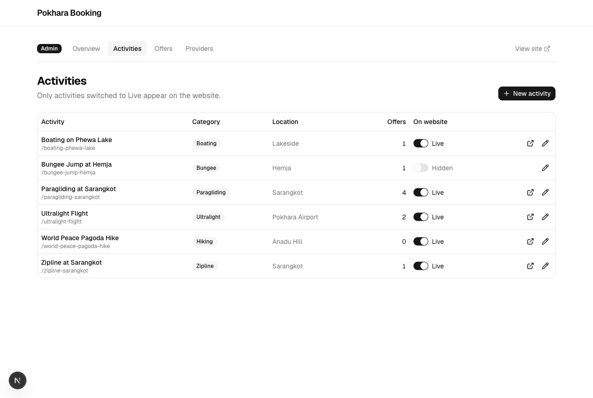
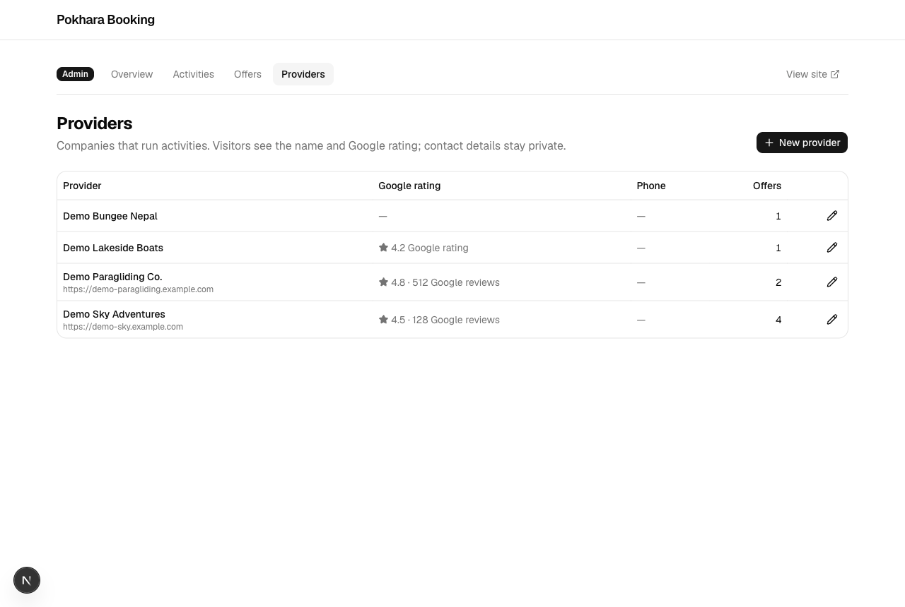
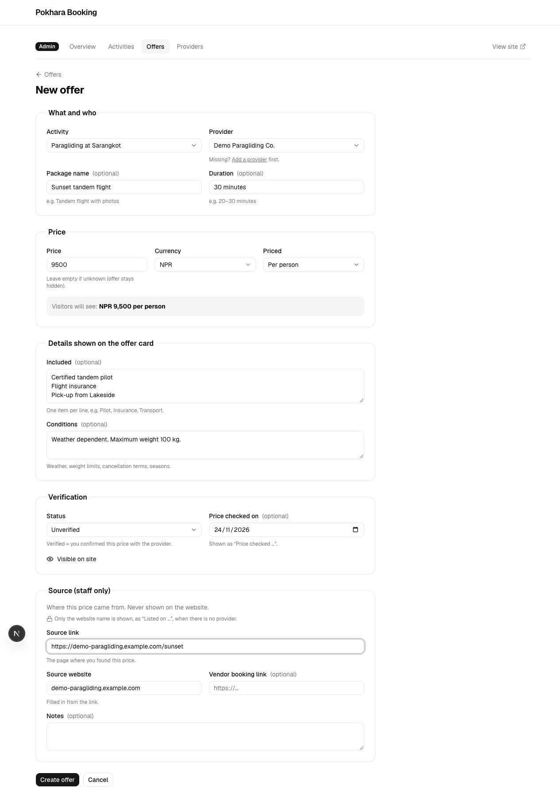

# Pokhara Booking — Admin guide

This guide is for staff who keep the website's activities, prices and companies up to date. No technical knowledge needed.

**In short:** you add **activities** (things to do), **providers** (the companies that run them) and **offers** (a provider's price for an activity). Visitors compare offers and send booking requests. Nothing you do here deletes anything: you hide things instead.

---

## Contents

1. [Getting in](#1-getting-in)
2. [The overview](#2-the-overview)
3. [What visitors can see](#3-what-visitors-can-see)
4. [Activities](#4-activities)
5. [Providers](#5-providers)
6. [Offers and prices](#6-offers-and-prices)
7. [Everyday tasks, step by step](#7-everyday-tasks-step-by-step)
8. [Booking requests and price changes](#8-booking-requests-and-price-changes)
9. [Something went wrong?](#9-something-went-wrong)
10. [Do and don't](#10-do-and-dont)
11. [For developers](#11-for-developers)

---

## 1. Getting in

1. Open **`/admin`** on the website, for example `http://localhost:3000/admin`.
2. Your browser shows a small sign-in box.
   - **Username:** anything (for example `admin`).
   - **Password:** the admin password your developer gave you.
3. Your browser remembers it until you close it.

There is no "Admin" link on the public website on purpose. Bookmark `/admin`.

> If you see **"Admin is disabled"**, the password hasn't been set up on this server yet. Ask your developer (see [For developers](#11-for-developers)).

Every admin page has the same menu at the top: **Overview · Activities · Offers · Providers**, and **View site** on the right, which opens the public website in a new tab.

---

## 2. The overview

| Card | What it tells you |
|---|---|
| **Activities** | How many are live on the website, out of all you've added. |
| **Offers** | All prices, with how many are unverified, outdated or missing a price. |
| **Providers** | How many companies you've added. |
| **Pending booking requests** | Requests from visitors waiting for a reply. (The screen to review them is coming in the next update.) |

Click a card to jump to that section.

---

## 3. What visitors can see

The website shows things only when all of these are true:

| Visitors see… | …only if |
|---|---|
| An **activity** | It is switched to **Live**. |
| An **offer** on that activity | It has a **price and currency**, it is **not outdated**, and its activity is **Live**. |
| A **provider's name and Google rating** | They have at least one visible offer. |

**Never shown to visitors:** provider phone numbers, addresses, websites, Google Maps links, notes, and the source links of prices.

The **Offers** table tells you for every offer whether it's visible, and if not, why (for example *Hidden: no price*).

This is what a visitor sees on an activity page: the photo with its credit, the description, then the offers to compare.

---

## 4. Activities

The table lists every activity with its category, location, number of offers and a **Live / Hidden** switch.

- **Live / Hidden switch:** click to publish or hide an activity straight away. A message confirms the change. Hiding an activity also hides all its offers. Nothing is deleted, and you can switch it back on any time.
- **↗ icon:** opens the live page (only for Live activities).
- **✎ icon or the name:** edit the activity.
- **Offers number:** shows the offers for that activity.

### Adding an activity

Click **New activity** (top right) and fill in:

| Field | Tips |
|---|---|
| **Name** | What visitors see as the title, e.g. *Paragliding at Sarangkot*. |
| **Web address (slug)** | Filled in for you from the name. It becomes the page address, e.g. `/activities/paragliding-sarangkot`. Use lowercase letters, numbers and dashes only. |
| **Category** | One word like *paragliding*, *boating*, *hiking*. Start typing to reuse an existing one, so similar activities stay grouped. |
| **Location** | Short place name: *Sarangkot*, *Lakeside*. |
| **Description** | 2–4 plain sentences. Press Enter for a new line. Don't put prices here; prices belong on offers. |
| **Image link** | See [Photos](#photos). Leave empty to show a simple mountain placeholder. |
| **Photo credit** | Who took the photo and its licence, shown under the photo. See [Photos](#photos). |
| **Live switch** | Leave it **off** while you prepare the activity and its offers, then switch it on. |

Click **Create activity**. You'll go back to the list with a confirmation message.

### Changing an activity's web address

If an activity is **Live**, changing its slug shows a warning: links people have already shared (WhatsApp, Facebook, Google) will stop working. Only change it to fix a real mistake.

If you pick a slug that's already used, the form tells you which activity has it.

### Photos

- The link must start with **`https://`** and point straight at an image file. A preview appears under the field as soon as the link works.
- **Landscape (wide) photos** look best: the site crops to a 16:9 frame.
- **Only use photos you're allowed to use:** your own, the provider's (with permission), or freely licensed ones such as Wikimedia Commons.
- Fill in **Photo credit** whenever the licence asks for it (Creative Commons "BY" licences always do), e.g. `Photo: Jane Doe, CC BY-SA 4.0, via Wikimedia Commons`. It appears in small text under the photo. The current photos and their licences are listed in [`docs/image-credits.md`](image-credits.md).
- If a photo doesn't show on the site, open the link in a new browser tab. If it doesn't show there either, the link is wrong.

---

## 5. Providers

A provider is a company that runs activities (a paragliding company, a boat station…). The table shows each one's Google rating, phone and how many offers it has.

Click **New provider**, or a provider's name, to edit. The form has two parts:

**Shown to visitors**

| Field | Tips |
|---|---|
| **Company name** | Shown on each of their offer cards. |
| **Google rating** | From their Google Maps page, 0–5 with one decimal (e.g. `4.7`). |
| **Review count** | The number next to the rating on Google. Needs a rating too. |
| **Rating checked on** | The day you copied the rating, so you know when to refresh it. |

**Staff only** (never shown on the website): phone, website, address, Google Maps link, notes.

Visitors see the rating as **★ 4.7 · 312 Google reviews**.

---

## 6. Offers and prices

An offer is one provider's price for one activity. One activity can (and should) have several offers, so visitors can compare.

### Filtering

Use the **Activity** and **Status** drop-downs above the table to narrow the list, for example *all unverified offers* when you do your weekly price check.

### Columns

| Column | Meaning |
|---|---|
| **Offer** | Package name, then activity · provider. |
| **Price** | What visitors see, or *No price*. |
| **Status** | **Verified** (you confirmed the price with the provider), **Unverified** (found it, not confirmed yet), **Outdated** (no longer valid, hidden). |
| **On website** | *Visible on site*, or why it's hidden. |
| **Price checked** | When the price was last confirmed. Visitors see "Price checked 10 Nov 2026". |

### Quick buttons on each row

| Button | What it does |
|---|---|
| **Verify** | You've just confirmed this price with the provider. Sets status to Verified **and the price-checked date to today**. |
| **Re-check** | Same as Verify, for an offer that's already verified: use it when you re-confirm the price, to refresh the date. |
| **Outdated** | The price is no longer valid. The offer disappears from the website immediately. |
| **✎** | Open the full form. |

### Adding an offer

Click **New offer**:

**What and who**
- **Activity**: hidden activities are marked *(hidden)*.
- **Provider**: pick the company. If it isn't in the list, use the *Add a provider* link first. If you really don't know the company (e.g. a price from a listing site), choose **No provider**: visitors then see "Listed on *website name*".
- **Package name** and **Duration**: e.g. *Tandem flight with photos*, *20–30 minutes*.

**Price**
- **Price**: numbers only; commas are fine (`12,500`). Leave empty if you don't know the price yet. The offer then stays hidden.
- **Currency**: NPR, USD, INR or EUR.
- **Priced**: how the price works. This decides the total visitors see when they request a booking:

| Priced | Example | Total for 3 people | Can visitors request online? |
|---|---|---|---|
| Per person | NPR 8,500 per person | NPR 25,500 | Yes |
| Per group (flat) | NPR 1,500 per group | NPR 1,500 | Yes |
| Per flight (flat) | NPR 13,000 per flight | NPR 13,000 | Yes |
| Per hour | NPR 2,000 per hour | — | No, shown as "Online requests aren't available" |
| Other | — | — | No |

The grey **Visitors will see** box previews the price exactly as it will appear.

**Details shown on the offer card**
- **Included**: one item per line (Pilot, Insurance, Transport…).
- **Conditions**: weather, weight limits, cancellation terms, seasons.

**Verification**
- **Status**: start with *Unverified* until you've confirmed the price with the provider.
- **Price checked on**: today by default.
- Under it, the form tells you whether this offer **will be visible** and if not, why.

**Source (staff only)**
- **Source link** *(required)*: the web page where you found the price. **Source website** fills itself in from the link.
- **Vendor booking link** and **Notes**: for staff only.

Click **Create offer**.

### Visitors compare offers like this

Offers on an activity page are sorted by currency (NPR first), then cheapest first. Visitors see the provider, rating, package, duration, price, a **Verified** or **Unverified price** badge, the price-checked date, what's included and the conditions. They never see the source link or your notes.

---

## 7. Everyday tasks, step by step

### A new company wants to list its paragliding prices
1. **Providers → New provider**: name, Google rating, phone (staff only). **Create provider**.
2. **Offers → New offer**: Activity = *Paragliding at Sarangkot*, Provider = the new company, package, price, *Per person*, what's included, source link. Status **Verified** if they gave you the price directly. **Create offer**.
3. Click **View site** and check the paragliding page.

### A provider changed its price
1. **Offers**, filter by the activity, click the offer.
2. Change the price, set Status to **Verified**, set **Price checked on** to today. **Save changes**.
   Requests visitors already sent keep the old price ([why](#8-booking-requests-and-price-changes)).

### A provider stopped offering a package
Click **Outdated** on that row. It vanishes from the website immediately. Don't edit it into a different package; create a new offer instead, so history stays correct.

### Weekly price check
1. **Offers**, Status = **Unverified** (then repeat for Verified offers older than a month).
2. Call or message each provider. If the price is still right, click **Verify** or **Re-check**. If it changed, edit it. If it's gone, click **Outdated**.

### Preparing a new activity before launch
1. **Activities → New activity**, leave **Live** off. Add the photo and description.
2. Add its offers (they'll show *Hidden: activity not published*).
3. When it's ready, switch the activity to **Live** in the Activities table.

### Pausing an activity for the monsoon
Switch it to **Hidden** in the Activities table. Its offers are kept. Switch it back to **Live** when the season starts. Refresh prices if needed.

---

## 8. Booking requests and price changes

When a visitor sends a booking request, the website saves **a copy of the offer exactly as they saw it**: price, total, what's included, conditions. Editing or outdating the offer later **never changes requests that were already sent**. So:

- Changing a price is safe. Only new requests use the new price.
- If a visitor has the page open while you change the price, the website stops them, shows the new price, and asks them to confirm before sending.
- If you mark an offer outdated while a visitor is filling in the form, their request is refused with "This offer is no longer available".

---

## 9. Something went wrong?

| You see | What to do |
|---|---|
| The browser keeps asking for the password | Check the password (it's case-sensitive). Any username works. |
| "Admin is disabled" | The server has no admin password set. Ask your developer. |
| Red text under a field | That field needs fixing; everything else you typed is kept. |
| "This slug is already used by …" | Choose a different web address, e.g. add the place: `boating-begnas-lake`. |
| "Image link must be a full link starting with https://" | Copy the image's own link (right-click the image → *Copy image address*). |
| "Choose a currency for this price" | A price needs a currency, and a currency needs a price. |
| "Add the rating too, or clear the review count" | A review count needs a Google rating. |
| An offer doesn't appear on the website | Look at its **On website** column: it says why (no price, outdated, or activity hidden). |
| An activity doesn't appear | Its switch is on **Hidden**. |
| A provider doesn't appear | They have no visible offers yet. |
| "Something went wrong while saving" | Try again. If it keeps happening, tell your developer the time it happened. |
| "Admin password required. Reload the page…" | Your sign-in expired: reload and enter the password again. |

---

## 10. Do and don't

**Do**
- Keep new activities **Hidden** until their photo, description and at least one offer are ready.
- Add **several offers** per activity so visitors can compare.
- Mark prices **Verified** only after confirming them with the provider, and keep the price-checked date honest.
- Use **Outdated** for prices that no longer apply.
- Fill in **Included** and **Conditions**: visitors compare what's included, not just the price.

**Don't**
- Don't put prices, phone numbers or private notes in public fields (name, description, included, conditions).
- Don't reuse an old offer for a different package. Create a new one.
- Don't change the web address of a live activity unless you must.
- Don't use photos you found online without permission or a free licence.
- Don't share the admin password in group chats.

---

## 11. For developers

- **Access:** `/admin` uses the browser's built-in password prompt (HTTP Basic Auth) with one shared password from `ADMIN_PASSWORD` in `.env.local` (8+ characters; any username). With no password set, `/admin` returns 503 and stays locked. There are no user accounts or Supabase Auth (see `AGENTS.md`).
- **Server Actions** can be called from any URL, so every admin action and admin data read re-checks the password (`requireAdmin()` in `src/lib/admin/guard.ts`), not just `src/proxy.ts`.
- Admin reads and writes use `SUPABASE_SERVICE_ROLE_KEY` (server-only). The public key stays read-only and cannot see hidden rows.
- **Before deploying:** set a long, unique `ADMIN_PASSWORD` in the hosting provider's environment settings, serve the site over HTTPS only, and rotate the password when staff leave.
- Spec and implementation notes: [`docs/tasks/04-admin-listings.md`](tasks/04-admin-listings.md).
